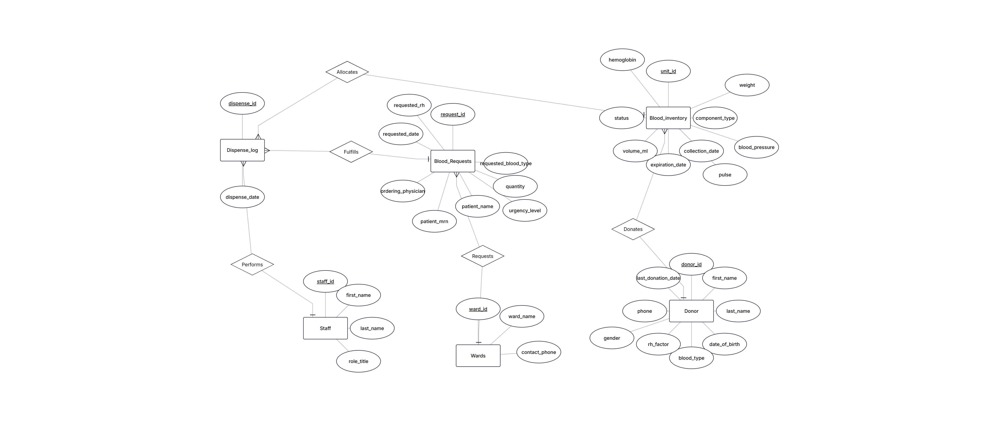
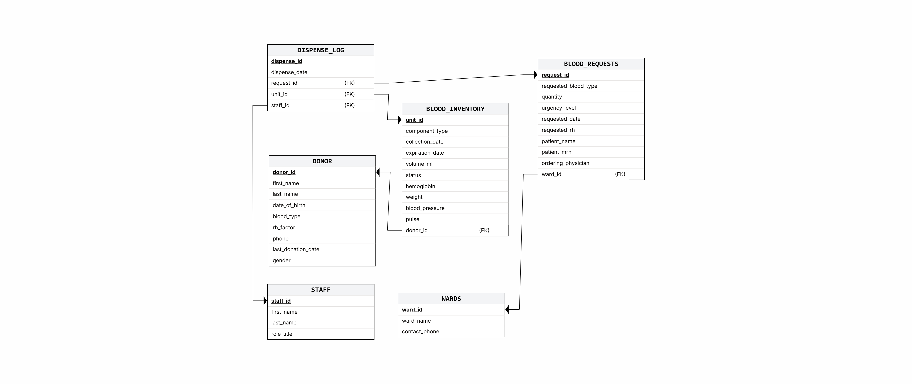

# DBProject_1172_9751
# מיני פרויקט בבסיסי נתונים: מחלקת בנק הדם
**מגישות: מירי מרמורשטיין וברכה רוזנפלד**

## 1. מבוא ומטרת המערכת
מערכת HemaCore לניהול בנק דם בבית חולים נועדה לנהל ולעקוב אחר מחזור החיים השלם של מנות דם, החל משלב קליטת התורם ועד לניפוק המנה למחלקה הדורשת. מטרתה המרכזית של המערכת היא להבטיח ניהול מלאי קפדני וזמינות של רכיבי דם מצילי חיים, תוך הקפדה על נהלי בטיחות, מעקב תפוגה והתאמת סוגי דם.

הנתונים העיקריים הנשמרים במערכת כוללים: 
מידע דמוגרפי וקליני של תורמים, מלאי פיזי של מנות הדם (תאריכי איסוף, תפוגה, מדדים כמו המוגלובין ומשקל), רשימת מחלקות דורשות, מעקב אחר בקשות דם ממחלקות (כולל רמת דחיפות ופרטי המטופל), וניהול צוות העובדים. 

הפונקציונליות העיקרית במערכת מבוססת על טבלת טרנזקציות (יומן ניפוקים) המתעדת בזמן אמת כל שיוך של מנת דם לבקשה רפואית על ידי הצוות המוסמך, תוך בקרה על סטטוס המנות.

---

## 2. אפיון מסכים (UI/UX)
אפיון המערכת בוצע בגישת Top-Down תוך שימוש ב-Google AI Studio ליצירת ממשק המשתמש (HTML/Tailwind), המציג את תזרים העבודה המרכזי במערכת.

🔗 **[לצפייה באפיון המערכת האינטראקטיבי לחצו כאן](https://bracha-rosenfeld.github.io/DBProject/index.html)**

**מסכי המערכת:**
1.  **Inventory Dashboard:** תצוגת מחוונים למעקב אחר מלאי לפי קבוצות דם, רכיבים והתראות תפוגה דחופות.
2.  **Donor & Donation Intake:** טופס לרישום תורמים וקליטת מנות דם, כולל הזנת מדדים קליניים.
3.  **Ward Blood Requests:** ממשק להזנת דרישות דם ממחלקות, כולל פרטי המטופל ורמת דחיפות.
4.  **Dispense Management:** מסך לניהול ואישור בקשות פתוחות, ושיוך מנות דם מתוך המלאי.

---

## 3. מילון נתונים וטבלאות

### טבלת תורמים (`DONOR`)
טבלה זו מרכזת את המידע הדמוגרפי והרפואי הבסיסי של כל תורם דם. היא משמשת לזיהוי התורמים, מעקב אחר התרומות שלהם וקביעת זכאותם לתרום דם בעתיד. טבלה זו מנהלת קשר 1:N עם טבלת `BLOOD_INVENTORY` (מלאי מנות הדם), כך שתורם אחד יכול לתרום מספר מנות דם לאורך זמן.

| מפתח | שם שדה | סוג נתון | תיאור |
| :--- | :--- | :--- | :--- |
| **PK** 🔑 | `donor_id` | `VARCHAR` | תעודת זהות של התורם (מפתח ייחודי) |
| | `first_name` | `VARCHAR` | שם פרטי של התורם |
| | `last_name` | `VARCHAR` | שם משפחה של התורם |
| | `date_of_birth` | `DATE` | תאריך לידה |
| | `blood_type` | `VARCHAR` | קבוצת דם (A, B, AB, O) |
| | `rh_factor` | `VARCHAR` | סוג Rh (+ או -) |
| | `phone` | `VARCHAR` | מספר טלפון ליצירת קשר |
| | `last_donation_date` | `DATE` | תאריך תרומת הדם האחרונה |
| | `gender` | `VARCHAR` | מגדר התורם |

### טבלת מלאי מנות דם (`BLOOD_INVENTORY`)
טבלה זו משמשת למעקב וניהול של כל מנת דם פיזית הנמצאת במלאי בנק הדם. היא מכילה מידע על סוג המנה, תאריכי איסוף ותפוגה, מדדים רפואיים של התורם בעת התרומה, וסטטוס המנה הנוכחי. טבלה זו מקושרת לטבלת התורמים (`DONOR`) ומהווה מקור לאספקת מנות לבקשות דם.

| מפתח | שם שדה | סוג נתון | תיאור |
| :--- | :--- | :--- | :--- |
| **PK** 🔑 | `unit_id` | `VARCHAR` | מק"ט/ברקוד ייחודי של מנת הדם |
| | `component_type` | `VARCHAR` | סוג רכיב הדם (למשל: כדוריות דם אדומות, פלזמה) |
| | `collection_date` | `DATE` | תאריך איסוף מנת הדם |
| | `expiration_date` | `DATE` | תאריך תפוגה של מנת הדם |
| | `volume_ml` | `INTEGER` | נפח המנה |
| | `status` | `VARCHAR` | סטטוס נוכחי של המנה (למשל: זמינה, בפסילה, נופקה) |
| | `hemoglobin` | `NUMERIC` | רמת המוגלובין של התורם בעת התרומה |
| | `weight` | `NUMERIC` | משקל התורם בעת התרומה |
| | `blood_pressure` | `VARCHAR` | לחץ דם של התורם בעת התרומה |
| | `pulse` | `INTEGER` | דופק של התורם בעת התרומה |
| **FK** | `donor_id` | `VARCHAR` | תעודת זהות של התורם ממנו נלקחה המנה |

### טבלת מחלקות (`WARDS`)
טבלה זו מכילה את רשימת המחלקות בבית החולים שצורכות מנות דם. היא משמשת לזיהוי המחלקה המבקשת ולניתוב מנות הדם בהתאם. טבלה זו מנהלת קשר 1:N עם טבלת `BLOOD_REQUESTS` (בקשות דם), כך שמחלקה אחת יכולה להגיש מספר רב של בקשות.

| מפתח | שם שדה | סוג נתון | תיאור |
| :--- | :--- | :--- | :--- |
| **PK** 🔑 | `ward_id` | `INTEGER` | מזהה ייחודי למחלקה |
| | `ward_name` | `VARCHAR` | שם המחלקה |
| | `contact_phone` | `VARCHAR` | מספר טלפון ליצירת קשר עם המחלקה |

### טבלת בקשות דם (`BLOOD_REQUESTS`)
טבלה זו מתעדת את כל בקשות הדם המתקבלות מהמחלקות השונות. היא מכילה מידע על סוג וכמות הדם הנדרשת, רמת הדחיפות, פרטי המטופל לו מיועדת המנה ושם הרופא המזמין. טבלה זו מקושרת לטבלת המחלקות (`WARDS`) ומהווה את הבסיס לניפוק מנות דם.

| מפתח | שם שדה | סוג נתון | תיאור |
| :--- | :--- | :--- | :--- |
| **PK** 🔑 | `request_id` | `INTEGER` | מספר סידורי ייחודי של בקשת הדם |
| | `requested_blood_type`| `VARCHAR` | קבוצת דם נדרשת (A, B, AB, O) |
| | `quantity` | `INTEGER` | כמות מנות הדם המבוקשת |
| | `urgency_level` | `VARCHAR` | רמת דחיפות של הבקשה (למשל: דחוף, רגיל) |
| | `requested_date` | `DATE` | תאריך הבקשה |
| | `requested_rh` | `VARCHAR` | סוג Rh נדרש (+ או -) |
| | `patient_name` | `VARCHAR` | שם המטופל לו מיועדת מנת הדם |
| | `patient_mrn` | `VARCHAR` | מספר תיק רפואי של המטופל (MRN) |
| | `ordering_physician` | `VARCHAR` | הרופא המזמין את מנת הדם |
| **FK** | `ward_id` | `INTEGER` | מזהה המחלקה המבקשת |

### טבלת צוות רפואי (`STAFF`)
טבלה זו מנהלת את פרטי עובדי בנק הדם המוסמכים לאשר ולנפק מנות דם. היא משמשת לתיעוד זהות איש הצוות שביצע את הניפוק. טבלה זו מקושרת לטבלת יומן ניפוקים (`DISPENSE_LOG`).

| מפתח | שם שדה | סוג נתון | תיאור |
| :--- | :--- | :--- | :--- |
| **PK** 🔑 | `staff_id` | `VARCHAR` | מזהה ייחודי של איש הצוות (ת.ז. או מספר רישיון) |
| | `first_name` | `VARCHAR` | שם פרטי של איש הצוות |
| | `last_name` | `VARCHAR` | שם משפחה של איש הצוות |
| | `role_title` | `VARCHAR` | תפקיד / תואר (למשל: אח, טכנאי דם) |

### טבלת יומן ניפוקים (`DISPENSE_LOG`)
זוהי טבלת טרנזקציות (ישות מקשרת M:N) המרכזת את כל הפעולות של ניפוק מנות דם ממלאי בנק הדם אל המחלקות המבקשות. היא מקשרת בין בקשת דם ספציפית (`BLOOD_REQUESTS`), מנת הדם שנופקה (`BLOOD_INVENTORY`), ואיש הצוות שביצע את הפעולה (`STAFF`).

| מפתח | שם שדה | סוג נתון | תיאור |
| :--- | :--- | :--- | :--- |
| **PK** 🔑 | `dispense_id` | `INTEGER` | מזהה טרנזקציה ייחודי |
| | `dispense_date` | `DATE` | תאריך ביצוע הניפוק |
| **FK** | `request_id` | `INTEGER` | מזהה בקשת הדם שאושרה ומומשה |
| **FK** | `unit_id` | `VARCHAR` | מק"ט מנת הדם שנופקה בפועל |
| **FK** | `staff_id` | `VARCHAR` | מזהה איש הצוות שביצע ואישר את הניפוק |

---

## 4. עיצוב בסיס הנתונים (ERD & DSD)

