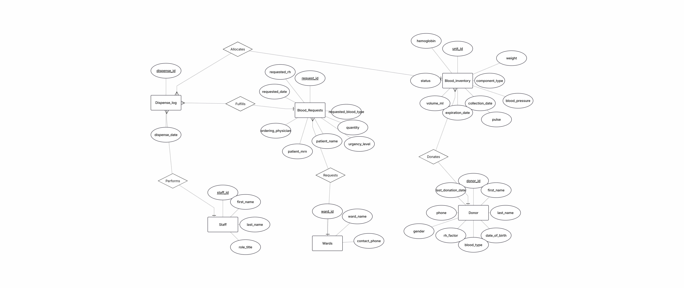
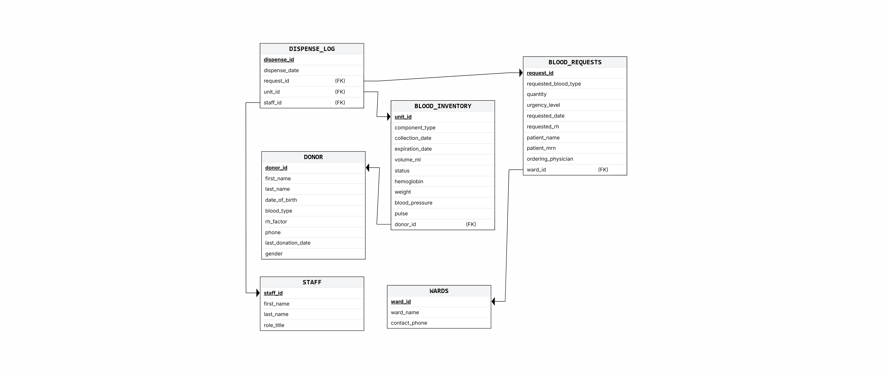
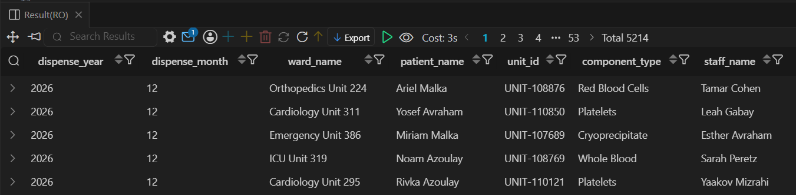

# DBProject_1172_9751
# מיני פרויקט בבסיסי נתונים: מחלקת בנק הדם
**מגישות: מירי מרמורשטיין וברכה רוזנפלד**

## 1. מבוא ומטרת המערכת
מערכת HemaCore לניהול בנק דם בבית חולים נועדה לנהל ולעקוב אחר מחזור החיים השלם של מנות דם, החל משלב קליטת התורם ועד לניפוק המנה למחלקה הדורשת. מטרתה המרכזית של המערכת היא להבטיח ניהול מלאי קפדני וזמינות של רכיבי דם מצילי חיים, תוך הקפדה על נהלי בטיחות, מעקב תפוגה והתאמת סוגי דם.

הנתונים העיקריים הנשמרים במערכת כוללים: 
מידע דמוגרפי וקליני של תורמים, מלאי פיזי של מנות הדם (תאריכי איסוף, תפוגה, מדדים כמו המוגלובין ומשקל), רשימת מחלקות דורשות, מעקב אחר בקשות דם ממחלקות (כולל רמת דחיפות ופרטי המטופל), וניהול צוות העובדים. 

הפונקציונליות העיקרית במערכת מבוססת על טבלת טרנזקציות (יומן ניפוקים) המתעדת בזמן אמת כל שיוך של מנת דם לבקשה רפואית על ידי הצוות המוסמך, תוך בקרה על סטטוס המנות.

---

## 2. אפיון מסכים (UI/UX)
אפיון המערכת בוצע בגישת Top-Down תוך שימוש ב-Google AI Studio ליצירת ממשק המשתמש (HTML/Tailwind), המציג את תזרים העבודה המרכזי במערכת.

🔗 **[לצפייה באפיון המערכת האינטראקטיבי לחצו כאן](https://bracha-rosenfeld.github.io/DBProject/index.html)**

**מסכי המערכת:**
1.  **Inventory Dashboard:** תצוגת מחוונים למעקב אחר מלאי לפי קבוצות דם, רכיבים והתראות תפוגה דחופות.
2.  **Donor & Donation Intake:** טופס לרישום תורמים וקליטת מנות דם, כולל הזנת מדדים קליניים.
3.  **Ward Blood Requests:** ממשק להזנת דרישות דם ממחלקות, כולל פרטי המטופל ורמת דחיפות.
4.  **Dispense Management:** מסך לניהול ואישור בקשות פתוחות, ושיוך מנות דם מתוך המלאי.

---

## 3. מילון נתונים וטבלאות

### טבלת תורמים (`DONOR`)
טבלה זו מרכזת את המידע הדמוגרפי והרפואי הבסיסי של כל תורם דם. היא משמשת לזיהוי התורמים, מעקב אחר התרומות שלהם וקביעת זכאותם לתרום דם בעתיד. טבלה זו מנהלת קשר 1:N עם טבלת `BLOOD_INVENTORY` (מלאי מנות הדם), כך שתורם אחד יכול לתרום מספר מנות דם לאורך זמן.

| מפתח | שם שדה | סוג נתון | תיאור |
| :--- | :--- | :--- | :--- |
| **PK** 🔑 | `donor_id` | `VARCHAR` | תעודת זהות של התורם (מפתח ייחודי) |
| | `first_name` | `VARCHAR` | שם פרטי של התורם |
| | `last_name` | `VARCHAR` | שם משפחה של התורם |
| | `date_of_birth` | `DATE` | תאריך לידה |
| | `blood_type` | `VARCHAR` | קבוצת דם (A, B, AB, O) |
| | `rh_factor` | `VARCHAR` | סוג Rh (+ או -) |
| | `phone` | `VARCHAR` | מספר טלפון ליצירת קשר |
| | `last_donation_date` | `DATE` | תאריך תרומת הדם האחרונה |
| | `gender` | `VARCHAR` | מגדר התורם |

### טבלת מלאי מנות דם (`BLOOD_INVENTORY`)
טבלה זו משמשת למעקב וניהול של כל מנת דם פיזית הנמצאת במלאי בנק הדם. היא מכילה מידע על סוג המנה, תאריכי איסוף ותפוגה, מדדים רפואיים של התורם בעת התרומה, וסטטוס המנה הנוכחי. טבלה זו מקושרת לטבלת התורמים (`DONOR`) ומהווה מקור לאספקת מנות לבקשות דם.

| מפתח | שם שדה | סוג נתון | תיאור |
| :--- | :--- | :--- | :--- |
| **PK** 🔑 | `unit_id` | `VARCHAR` | מק"ט/ברקוד ייחודי של מנת הדם |
| | `component_type` | `VARCHAR` | סוג רכיב הדם (למשל: כדוריות דם אדומות, פלזמה) |
| | `collection_date` | `DATE` | תאריך איסוף מנת הדם |
| | `expiration_date` | `DATE` | תאריך תפוגה של מנת הדם |
| | `volume_ml` | `INTEGER` | נפח המנה |
| | `status` | `VARCHAR` | סטטוס נוכחי של המנה (למשל: זמינה, בפסילה, נופקה) |
| | `hemoglobin` | `NUMERIC` | רמת המוגלובין של התורם בעת התרומה |
| | `weight` | `NUMERIC` | משקל התורם בעת התרומה |
| | `blood_pressure` | `VARCHAR` | לחץ דם של התורם בעת התרומה |
| | `pulse` | `INTEGER` | דופק של התורם בעת התרומה |
| **FK** | `donor_id` | `VARCHAR` | תעודת זהות של התורם ממנו נלקחה המנה |

### טבלת מחלקות (`WARDS`)
טבלה זו מכילה את רשימת המחלקות בבית החולים שצורכות מנות דם. היא משמשת לזיהוי המחלקה המבקשת ולניתוב מנות הדם בהתאם. טבלה זו מנהלת קשר 1:N עם טבלת `BLOOD_REQUESTS` (בקשות דם), כך שמחלקה אחת יכולה להגיש מספר רב של בקשות.

| מפתח | שם שדה | סוג נתון | תיאור |
| :--- | :--- | :--- | :--- |
| **PK** 🔑 | `ward_id` | `INTEGER` | מזהה ייחודי למחלקה |
| | `ward_name` | `VARCHAR` | שם המחלקה |
| | `contact_phone` | `VARCHAR` | מספר טלפון ליצירת קשר עם המחלקה |

### טבלת בקשות דם (`BLOOD_REQUESTS`)
טבלה זו מתעדת את כל בקשות הדם המתקבלות מהמחלקות השונות. היא מכילה מידע על סוג וכמות הדם הנדרשת, רמת הדחיפות, פרטי המטופל לו מיועדת המנה ושם הרופא המזמין. טבלה זו מקושרת לטבלת המחלקות (`WARDS`) ומהווה את הבסיס לניפוק מנות דם.

| מפתח | שם שדה | סוג נתון | תיאור |
| :--- | :--- | :--- | :--- |
| **PK** 🔑 | `request_id` | `INTEGER` | מספר סידורי ייחודי של בקשת הדם |
| | `requested_blood_type`| `VARCHAR` | קבוצת דם נדרשת (A, B, AB, O) |
| | `quantity` | `INTEGER` | כמות מנות הדם המבוקשת |
| | `urgency_level` | `VARCHAR` | רמת דחיפות של הבקשה (למשל: דחוף, רגיל) |
| | `requested_date` | `DATE` | תאריך הבקשה |
| | `requested_rh` | `VARCHAR` | סוג Rh נדרש (+ או -) |
| | `patient_name` | `VARCHAR` | שם המטופל לו מיועדת מנת הדם |
| | `patient_mrn` | `VARCHAR` | מספר תיק רפואי של המטופל (MRN) |
| | `ordering_physician` | `VARCHAR` | הרופא המזמין את מנת הדם |
| **FK** | `ward_id` | `INTEGER` | מזהה המחלקה המבקשת |

### טבלת צוות רפואי (`STAFF`)
טבלה זו מנהלת את פרטי עובדי בנק הדם המוסמכים לאשר ולנפק מנות דם. היא משמשת לתיעוד זהות איש הצוות שביצע את הניפוק. טבלה זו מקושרת לטבלת יומן ניפוקים (`DISPENSE_LOG`).

| מפתח | שם שדה | סוג נתון | תיאור |
| :--- | :--- | :--- | :--- |
| **PK** 🔑 | `staff_id` | `VARCHAR` | מזהה ייחודי של איש הצוות (ת.ז. או מספר רישיון) |
| | `first_name` | `VARCHAR` | שם פרטי של איש הצוות |
| | `last_name` | `VARCHAR` | שם משפחה של איש הצוות |
| | `role_title` | `VARCHAR` | תפקיד / תואר (למשל: אח, טכנאי דם) |

### טבלת יומן ניפוקים (`DISPENSE_LOG`)
זוהי טבלת טרנזקציות (ישות מקשרת M:N) המרכזת את כל הפעולות של ניפוק מנות דם ממלאי בנק הדם אל המחלקות המבקשות. היא מקשרת בין בקשת דם ספציפית (`BLOOD_REQUESTS`), מנת הדם שנופקה (`BLOOD_INVENTORY`), ואיש הצוות שביצע את הפעולה (`STAFF`).

| מפתח | שם שדה | סוג נתון | תיאור |
| :--- | :--- | :--- | :--- |
| **PK** 🔑 | `dispense_id` | `INTEGER` | מזהה טרנזקציה ייחודי |
| | `dispense_date` | `DATE` | תאריך ביצוע הניפוק |
| **FK** | `request_id` | `INTEGER` | מזהה בקשת הדם שאושרה ומומשה |
| **FK** | `unit_id` | `VARCHAR` | מק"ט מנת הדם שנופקה בפועל |
| **FK** | `staff_id` | `VARCHAR` | מזהה איש הצוות שביצע ואישר את הניפוק |

---

## 4. עיצוב בסיס הנתונים (ERD & DSD)




## 5. שאילתות

### א. שאילתות SELECT כפולות (כולל השוואת יעילות)

#### שאילתה 1: פירוט ניפוקי דם דחופים (`Stat`) לפי שנה וחודש
השאילתה מציגה פירוט מלא של כל מנות הדם שנופקו עבור בקשות דחופות (`Stat`) – כולל שנת וחודש הניפוק, שם המחלקה, שם המטופל, מזהה המנה, סוג הרכיב ושם איש הצוות שאישר את הניפוק.

**צורה א' – שימוש ב-`JOIN` ישיר:**
```sql
SELECT 
    EXTRACT(YEAR FROM dl.dispense_date) AS dispense_year,
    EXTRACT(MONTH FROM dl.dispense_date) AS dispense_month,
    w.ward_name,
    br.patient_name,
    bi.unit_id,
    bi.component_type,
    s.first_name || ' ' || s.last_name AS staff_name
FROM dispense_log dl
JOIN blood_requests br ON dl.request_id = br.request_id
JOIN wards w ON br.ward_id = w.ward_id
JOIN blood_inventory bi ON dl.unit_id = bi.unit_id
JOIN staff s ON dl.staff_id = s.staff_id
WHERE br.urgency_level = 'Stat'
ORDER BY dispense_year DESC, dispense_month DESC;
```


**צורה ב' – שימוש בתת-שאילתה עם `IN`:**
```sql
SELECT 
    EXTRACT(YEAR FROM dl.dispense_date) AS dispense_year,
    EXTRACT(MONTH FROM dl.dispense_date) AS dispense_month,
    w.ward_name,
    br.patient_name,
    bi.unit_id,
    bi.component_type,
    s.first_name || ' ' || s.last_name AS staff_name
FROM dispense_log dl
JOIN blood_requests br ON dl.request_id = br.request_id
JOIN wards w ON br.ward_id = w.ward_id
JOIN blood_inventory bi ON dl.unit_id = bi.unit_id
JOIN staff s ON dl.staff_id = s.staff_id
WHERE dl.request_id IN (
    SELECT request_id 
    FROM blood_requests 
    WHERE urgency_level = 'Stat'
)
ORDER BY dispense_year DESC, dispense_month DESC;
```


**השוואת יעילות:**
צורה א' (`JOIN` ישיר) יעילה וקריאה יותר, שכן טבלת `blood_requests` כבר מחוברת לשאילתה והסינון מתבצע ישירות עליה. בצורה ב' מתבצעת גישה נוספת (תת-שאילתה) לאותה טבלה (`blood_requests`) לצורך סינון ה-`IN`, מה שמוסיף תקורה מיותרת לתוכנית הביצוע.

---

#### שאילתה 2: תורמים שתרמו מנות שכבר נופקו בפועל למחלקות
השאילתה מאתרת את כל התורמים שתרמו מנות דם שכבר נופקו למחלקות (מופיעות ביומן הניפוקים), כולל סוג הדם המלא שלהם ופירוק תאריך התרומה האחרונה לשנה וחודש.

**צורה א' – שימוש ב-`EXISTS`:**
```sql
SELECT 
    d.donor_id,
    d.first_name || ' ' || d.last_name AS donor_name,
    d.blood_type || d.rh_factor AS full_blood_type,
    EXTRACT(YEAR FROM d.last_donation_date) AS last_year,
    EXTRACT(MONTH FROM d.last_donation_date) AS last_month
FROM donor d
WHERE EXISTS (
    SELECT 1
    FROM blood_inventory bi
    JOIN dispense_log dl ON bi.unit_id = dl.unit_id
    WHERE bi.donor_id = d.donor_id
)
ORDER BY last_year DESC, last_month DESC;
```


**צורה ב' – שימוש ב-`DISTINCT` ו-`JOIN`:**
```sql
SELECT DISTINCT
    d.donor_id,
    d.first_name || ' ' || d.last_name AS donor_name,
    d.blood_type || d.rh_factor AS full_blood_type,
    EXTRACT(YEAR FROM d.last_donation_date) AS last_year,
    EXTRACT(MONTH FROM d.last_donation_date) AS last_month
FROM donor d
JOIN blood_inventory bi ON d.donor_id = bi.donor_id
JOIN dispense_log dl ON bi.unit_id = dl.unit_id
ORDER BY last_year DESC, last_month DESC;
```


**השוואת יעילות:**
צורה א' (`EXISTS`) יעילה יותר מכיוון שהיא פועלת בשיטת *Semi-Join* ועוצרת מיד ברגע שנמצאת מנה אחת שנופקה עבור התורם. לעומת זאת, צורה ב' (`JOIN` + `DISTINCT`) מכפילה תחילה את כל שורות התורם כמספר המנות שתרם ונופקו, ורק לאחר מכן מבצעת פעולת `HashAggregate` / `Sort` יקרה כדי להסיר את הכפילויות.

---

#### שאילתה 3: בקשות דם פתוחות שטרם נופקה עבורן מנה
השאילתה מאתרת בקשות דם שממתינות לטיפול בתור העבודה של מסך הניפוק (אין להן עדיין רשומה ב-`dispense_log`), וממיינת אותן מהישנה לחדשה.

**צורה א' – שימוש ב-`LEFT JOIN` ו-`IS NULL`:**
```sql
SELECT 
    br.request_id,
    w.ward_name,
    br.patient_name,
    br.requested_blood_type || br.requested_rh AS needed_type,
    br.urgency_level,
    EXTRACT(DAY FROM br.requested_date) AS req_day,
    EXTRACT(MONTH FROM br.requested_date) AS req_month
FROM blood_requests br
JOIN wards w ON br.ward_id = w.ward_id
LEFT JOIN dispense_log dl ON br.request_id = dl.request_id
WHERE dl.dispense_id IS NULL
ORDER BY br.requested_date ASC;
```


**צורה ב' – שימוש ב-`NOT EXISTS`:**
```sql
SELECT 
    br.request_id,
    w.ward_name,
    br.patient_name,
    br.requested_blood_type || br.requested_rh AS needed_type,
    br.urgency_level,
    EXTRACT(DAY FROM br.requested_date) AS req_day,
    EXTRACT(MONTH FROM br.requested_date) AS req_month
FROM blood_requests br
JOIN wards w ON br.ward_id = w.ward_id
WHERE NOT EXISTS (
    SELECT 1 
    FROM dispense_log dl 
    WHERE dl.request_id = br.request_id
)
ORDER BY br.requested_date ASC;
```


**השוואת יעילות:**
צורה ב' (`NOT EXISTS`) נחשבת יעילה ומדויקת יותר למציאת חוסר התאמה (*Anti-Join*), מכיוון שהמנוע מפסיק לסרוק עבור בקשה מסוימת ברגע שנמצא ניפוק אחד עבורה. בצורה א' (`LEFT JOIN`), המנוע נדרש לצרף את השורות ורק בשלב ה-`WHERE` לסנן את ערכי ה-`NULL` (אף שבאופטימייזר של PostgreSQL שתי הצורות עשויות לקבל תוכנית דומה).

---

#### שאילתה 4: מנות זמינות עם רמת המוגלובין גבוהה מהממוצע של אותו רכיב
השאילתה מאתרת מנות דם זמינות במלאי שרמת ההמוגלובין שלהן גבוהה מממוצע ההמוגלובין של כלל המנות מאותו סוג רכיב (`component_type`).

**צורה א' – תת-שאילתה מתואמת ב-`WHERE`:**
```sql
SELECT 
    bi.unit_id,
    bi.component_type,
    d.blood_type || d.rh_factor AS blood_group,
    bi.hemoglobin,
    bi.expiration_date
FROM blood_inventory bi
JOIN donor d ON bi.donor_id = d.donor_id
WHERE bi.status = 'Available'
  AND bi.hemoglobin > (
      SELECT AVG(bi2.hemoglobin)
      FROM blood_inventory bi2
      WHERE bi2.component_type = bi.component_type
  )
ORDER BY bi.hemoglobin DESC;
```


**צורה ב' – `JOIN` לטבלה נגזרת עם `GROUP BY`:**
```sql
SELECT 
    bi.unit_id,
    bi.component_type,
    d.blood_type || d.rh_factor AS blood_group,
    bi.hemoglobin,
    bi.expiration_date
FROM blood_inventory bi
JOIN donor d ON bi.donor_id = d.donor_id
JOIN (
    SELECT component_type, AVG(hemoglobin) AS avg_hb
    FROM blood_inventory
    GROUP BY component_type
) avg_tbl ON bi.component_type = avg_tbl.component_type
WHERE bi.status = 'Available'
  AND bi.hemoglobin > avg_tbl.avg_hb
ORDER BY bi.hemoglobin DESC;
```


**השוואת יעילות:**
צורה ב' (`JOIN` עם `GROUP BY`) יעילה משמעותית, מכיוון שהיא מחשבת את ממוצע ההמוגלובין לכל סוג רכיב **פעם אחת בלבד** ולאחר מכן מצרפת את התוצאה לטבלת המלאי. בצורה א' (תת-שאילתה מתואמת), חישוב הממוצע עלול להתבצע מחדש עבור כל שורה בטבלת המלאי, מה שמאט מאוד את הריצה בטבלאות גדולות.

---

### ב. 4 שאילתות SELECT נוספות

#### שאילתה 5: סיכום מלאי זמין לפי קבוצת דם ורכיב (לדאשבורד)
השאילתה מסכמת את כמות המנות הזמינות במלאי, ממוצע ההמוגלובין ותאריך התפוגה הקרוב ביותר עבור כל קבוצת דם וסוג רכיב, ממוינות מהמלאי הנמוך ביותר לזיהוי מהיר של מחסורים.
```sql
SELECT 
    d.blood_type || d.rh_factor AS blood_group,
    bi.component_type,
    COUNT(bi.unit_id) AS available_units,
    ROUND(AVG(bi.hemoglobin), 2) AS avg_hemoglobin,
    MIN(bi.expiration_date) AS earliest_expiry
FROM blood_inventory bi
JOIN donor d ON bi.donor_id = d.donor_id
WHERE bi.status = 'Available'
GROUP BY d.blood_type, d.rh_factor, bi.component_type
ORDER BY available_units ASC;
```


#### שאילתה 6: התראות תפוגה – מנות זמינות שפגות תוקף בתוך 7 ימים
השאילתה מציגה את כלל המנות הזמינות שתוקפן יפוג בשבוע הקרוב ומחשבת כמה ימים נותרו לכל מנה, כדי לתעדף אותן לניפוק לפני השמדה.
```sql
SELECT 
    bi.unit_id,
    d.blood_type || d.rh_factor AS blood_group,
    bi.component_type,
    bi.collection_date,
    bi.expiration_date,
    (bi.expiration_date - CURRENT_DATE) AS days_left
FROM blood_inventory bi
JOIN donor d ON bi.donor_id = d.donor_id
WHERE bi.status = 'Available'
  AND bi.expiration_date BETWEEN CURRENT_DATE AND CURRENT_DATE + INTERVAL '7 days'
ORDER BY days_left ASC;
```


#### שאילתה 7: עומס עבודה חודשי של צוות בנק הדם
השאילתה מחשבת את כמות הניפוקים שביצע כל איש צוות בכל חודש ושנה, ומציגה רק עובדים שביצעו 5 ניפוקים ומעלה באותו חודש.
```sql
SELECT 
    s.staff_id,
    s.first_name || ' ' || s.last_name AS staff_name,
    s.role_title,
    EXTRACT(YEAR FROM dl.dispense_date) AS year,
    EXTRACT(MONTH FROM dl.dispense_date) AS month,
    COUNT(dl.dispense_id) AS total_dispenses
FROM staff s
JOIN dispense_log dl ON s.staff_id = dl.staff_id
GROUP BY s.staff_id, s.first_name, s.last_name, s.role_title, year, month
HAVING COUNT(dl.dispense_id) >= 5
ORDER BY year DESC, month DESC, total_dispenses DESC;
```


#### שאילתה 8: דירוג מחלקות לפי צריכת דם וכמות בקשות דחופות
השאילתה מדרגת את מחלקות בית החולים לפי סך מנות הדם שהזמינו, כולל ספירת סך הבקשות וכמות הבקשות הדחופות (`Stat`) של כל מחלקה.
```sql
SELECT 
    w.ward_id,
    w.ward_name,
    COUNT(br.request_id) AS total_requests,
    SUM(br.quantity) AS total_units_requested,
    SUM(CASE WHEN br.urgency_level = 'Stat' THEN 1 ELSE 0 END) AS Stat_requests
FROM wards w
JOIN blood_requests br ON w.ward_id = br.ward_id
GROUP BY w.ward_id, w.ward_name
ORDER BY total_units_requested DESC;
```


---

### ג. שאילתות UPDATE

#### עדכון 1: סימון אוטומטי של מנות שפג תוקפן כ-`Expired`
השאילתה מעדכנת לסטטוס `Expired` את כל המנות שנותרו בסטטוס `Available` למרות שתאריך התפוגה שלהן עבר והן לא נופקו למטופל.
```sql
UPDATE blood_inventory
SET status = 'Expired'
WHERE status = 'Available'
  AND expiration_date < CURRENT_DATE
  AND NOT EXISTS (
      SELECT 1
      FROM dispense_log dl
      WHERE dl.unit_id = blood_inventory.unit_id
  );
```
**לפני העדכון:**

**הרצה ואחרי העדכון:**


#### עדכון 2: סנכרון תאריך התרומה האחרונה של תורמים (`last_donation_date`)
השאילתה מעדכנת בטבלת התורמים את תאריך התרומה האחרונה לפי התאריך העדכני ביותר של אותו תורם בטבלת `blood_inventory`, לצורך בקרת זכאות לתרומה הבאה.
```sql
UPDATE donor d
SET last_donation_date = sub.max_date
FROM (
    SELECT donor_id, MAX(collection_date) AS max_date
    FROM blood_inventory
    GROUP BY donor_id
) sub
WHERE d.donor_id = sub.donor_id
  AND (d.last_donation_date IS NULL OR d.last_donation_date < sub.max_date);
```
**לפני העדכון:**

**הרצה ואחרי העדכון:**


#### עדכון 3: העלאת דחיפות בקשות `Urgent` שמתעכבות ל-`Stat`
השאילתה מעלה לדרגת `Stat` בקשות בדרגת `Urgent` שממתינות לניפוק יותר מ-3 ימים ועדיין לא טופלו (אינן מופיעות ב-`dispense_log`).
```sql
UPDATE blood_requests
SET urgency_level = 'Stat'
WHERE urgency_level = 'Urgent'
  AND requested_date < CURRENT_DATE - INTERVAL '3 days'
  AND NOT EXISTS (
      SELECT 1
      FROM dispense_log dl
      WHERE dl.request_id = blood_requests.request_id
  );
```
**לפני העדכון:**

**הרצה ואחרי העדכון:**


---

### ד. שאילתות DELETE

#### מחיקה 1: ניקוי בקשות שגרתיות (`Routine`) ישנות שלא מומשו מעל שנה
השאילתה מוחקת מתור העבודה בקשות שגרתיות שנפתחו לפני יותר משנה ומעולם לא נופקה להן מנת דם.
```sql
DELETE FROM blood_requests
WHERE urgency_level = 'Routine'
  AND requested_date < CURRENT_DATE - INTERVAL '1 year'
  AND NOT EXISTS (
      SELECT 1
      FROM dispense_log dl
      WHERE dl.request_id = blood_requests.request_id
  );
```
**לפני המחיקה:**

**הרצה ואחרי המחיקה:**


#### מחיקה 2: פינוי מנות פגות תוקף (`Expired`) ישנות מהמלאי הפעיל
השאילתה מוחקת מטבלת המלאי מנות בסטטוס `Expired` שתאריך התפוגה שלהן עבר לפני יותר מחצי שנה ולא נופקו מעולם.
```sql
DELETE FROM blood_inventory
WHERE status = 'Expired'
  AND expiration_date < CURRENT_DATE - INTERVAL '6 months'
  AND NOT EXISTS (
      SELECT 1
      FROM dispense_log dl
      WHERE dl.unit_id = blood_inventory.unit_id
  );
```
**לפני המחיקה:**

**הרצה ואחרי המחיקה:**


#### מחיקה 3: ניקוי בקשות חירום (`Stat` / `Emergency`) ישנות שנתקעו בתור
השאילתה מוחקת בקשות חירום שלא טופלו מעל 3 ימים (ולכן אינן רלוונטיות עוד או בוטלו), כדי לשמור על תור התראות נקי ומדויק במסך הניפוק.
```sql
DELETE FROM blood_requests br
WHERE br.urgency_level IN ('Stat', 'Emergency')
  AND br.requested_date < CURRENT_DATE - INTERVAL '3 days'
  AND NOT EXISTS (
      SELECT 1 FROM dispense_log dl WHERE dl.request_id = br.request_id
  );
```
**לפני המחיקה:**

**הרצה ואחרי המחיקה:**
